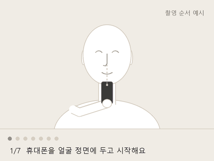
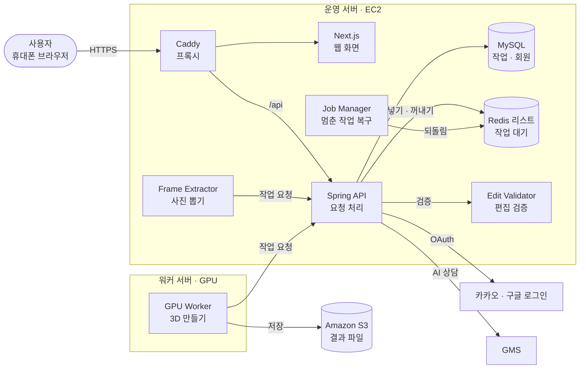

<div align="center">

<picture>
  <source media="(prefers-color-scheme: dark)" srcset="docs/assets/preface-logo-dark.png">
  
</picture>

**상상 말고, 내 3D 얼굴을 원하는 대로.**

휴대폰으로 얼굴을 한 바퀴 찍으면 내 3D 얼굴이 만들어지고,<br>
부위를 골라 원하는 만큼 바꿔 보며 전후를 비교하는 웹 서비스다.

[개인 기여](#개인-기여) · [로컬 실행](#로컬-실행) · [공개 범위](docs/public-scope.md)

<sub>SSAFY 15기 자율 프로젝트 · B204</sub>

</div>

<p align="center">
  <a href="#왜-만들었나">왜 만들었나</a> ·
  <a href="#주요-기능">주요 기능</a> ·
  <a href="#휴대폰-영상-47초가-3d-얼굴이-되기까지">3D 생성 과정</a> ·
  <a href="#개선-결과">개선 결과</a> ·
  <a href="#트러블슈팅">트러블슈팅</a> ·
  <a href="#시스템-아키텍처">아키텍처</a> ·
  <a href="#저장소-구조">저장소 구조</a> ·
  <a href="#팀">팀</a>
</p>

## 왜 만들었나

원하는 얼굴의 변화를 말이나 다른 사람의 사진만으로 설명하기는 어렵다. Preface는 자기 얼굴을 입체로 보고 직접 바꾸면서, 원하는 모습을 구체화할 수 있도록 만든 서비스다. 사전 사용자 조사에서도 기존 시뮬레이션과 상담의 어려움을 확인했다.

| 문제 | 조사 결과[^survey] |
| --- | --- |
| **2D 시뮬레이션의 한계** | 써 본 사람 중 실제 결정·상담에 참고한 사람은 **7.3%** |
| **병원 방문의 부담** | 1차 유저 테스트에서 성형외과에 직접 가서 상담받는 것이 부담스럽다는 의견이 나왔다 |
| **상담은 말과 남의 얼굴로 한다** | 71.4%가 원하는 모양을 말로 설명했고, 의사와 "같은 그림"을 그린다고 느낀 사람은 **42.9%** |

## 주요 기능

<table>
<tr>
<td width="50%" valign="top">

**📱 3D 얼굴 만들기**<br>
앱 설치 없이 휴대폰 브라우저로 녹화한다. 음성 안내를 따라 얼굴의 좌우·위아래를 천천히 담으면 된다.

</td>
<td width="50%" valign="top">

**🎚️ 성형 시뮬레이션**<br>
부위를 고르고 슬라이더를 움직이면 3D가 바로 바뀐다. 돌려 보며 옆모습까지 확인하고 전후를 비교한다.

</td>
</tr>
<tr>
<td valign="top">

**💬 AI 상담실장**<br>
고민을 말하면 AI가 어느 부위를 얼마나 바꾸면 좋을지 제안하고, 그 제안을 바로 편집에 반영한다.

</td>
<td valign="top">

**🙂 표정 트래킹**<br>
카메라 앞 얼굴을 MediaPipe가 읽고, 내 3D 얼굴이 고개 방향과 표정(미소·놀람·찡그림·볼 부풀리기)을 따라 한다.

</td>
</tr>
</table>

> 시뮬레이션이며 수술 결과 예측이 아니다.

## 휴대폰 영상 47초가 3D 얼굴이 되기까지

<table>
<tr>
<td width="50%" align="center"><br><sub>① 녹화: 음성 안내를 따라 얼굴을 한 바퀴 담는다</sub></td>
<td width="50%" align="center"><br><sub>④ 모든 결과는 같은 구조의 기본 머리에서 출발한다.<br>그래서 누구의 얼굴이든 같은 제어점으로 편집한다</sub></td>
</tr>
</table>

| 단계 | 하는 일 | 쓰는 기술 | 시연 녹화 1건의 수치 |
| --- | --- | --- | --- |
| ① 녹화 | 휴대폰으로 얼굴 한 바퀴 찍기 | 휴대폰 브라우저 · 음성 안내 · 자이로 | 46.9초, 1,406프레임 |
| ② 사진 고르기 | 각도마다 가장 선명한 사진 | 자이로·얼굴 각도 2.5° 칸 · 선명도 점수 | 91장 (흐림·눈 감음 제외) |
| ③ 카메라·깊이 | 카메라 위치와 얼굴 깊이 계산 | COLMAP SfM · SIFT 특징점 · 사람 분할 마스크 | 사진 87장이 함께 찾은 얼굴 점 3,962개 |
| ④ 머리 맞추기 | 기본 머리를 내 얼굴 모양으로 | Google GNM 통계 머리 · SfM 점 · 얼굴 윤곽 맞춤 | 정점 17,821개, 모두 같은 구조 |
| ⑤ 부위 맞추기 | 기본 머리가 못 만드는 부위를 사진으로 | 눈꺼풀 접힘선 · 코 옆선·콧구멍 · 얼굴·목 경계 | 3부위 |
| ⑥ 색 입히기 | 사진 색을 3D 피부에 입히기 | GPU 텍스처 굽기 · 사람별 헤어라인 · 민머리 피부 | 2048×2048 피부 지도 |
| ⑦ 결과 확인 | 실제 사진과 겹쳐 닮았는지 확인 | 찍은 카메라 그대로 3D를 그려 비교 | 만들 때 안 쓴 사진 18장으로 채점 |

## 개선 결과

<div align="center">

| 3D 생성 실패율 | 한 명 처리 시간 | 닮은 정도 (10점 만점) | 피부가 어색하다는 응답 |
| :---: | :---: | :---: | :---: |
| 34.5% → **9.3%** | 13분 37초 → **3분 24초** | 6.36 → **8.11** | 63.6% → **15.8%** |
| 운영 작업 기록[^ops] | PoC 단독 실행 → 운영 평균[^time] | 1·2차 유저 테스트[^ut] | 1·2차 유저 테스트[^ut] |

</div>

## 트러블슈팅

결과에 가장 크게 영향을 준 세 가지다. 그 밖에 부딪힌 문제(평균 얼굴로 채워진 부위, 쌍꺼풀이 사라짐, 기종마다 다른 카메라·자이로 축, 텍스처 이음매, 카톡 압축 화질 등)는 [발표 자료](https://preface-presentation.vercel.app)에 있다.

<details>
<summary><b>1. 옆에서 보면 코가 튀어나왔다 — 측면 깊이 부정확</b></summary>
<br>

- **문제**: MediaPipe 얼굴 점을 깊이 기준으로 삼으면 정면은 그럴듯해도 옆에서 코와 얼굴 윤곽이 어긋났다.
- **원인**: MediaPipe는 사진마다 468개 기준점을 새로 짐작해 찍는다. 고개를 돌릴수록 같은 번호의 점이 실제 피부 자리에서 미끄러져, 사진마다 다른 자리를 가리킨다.
- **해결**: SIFT로 눈꼬리·점·주름처럼 모양이 또렷한 곳을 사진끼리 짝짓고, COLMAP SfM으로 카메라 위치와 3D 점을 계산해 깊이와 머리 자세를 정했다. MediaPipe 점은 부위 이름표로만 쓴다.
- **결과**: 깊이는 SfM 점에서 얻고, MediaPipe는 얼굴 부위를 식별하는 단서로 사용하도록 역할을 나눴다. 사진의 측면 윤곽에 맞추는 방향으로 복원을 개선했다.

</details>

<details>
<summary><b>2. 세 번에 한 번 3D 생성이 실패했다 — 사진 고르기</b></summary>
<br>

- **문제**: 1차 배포 뒤 운영에서 55건 중 19건(34.5%)이 실패했다.
- **원인**: 영상을 같은 시간 간격으로 나눠 사진을 골랐다. 사람마다 찍는 방식이 달라, 오래 멈춘 정면에는 같은 각도 사진이 쌓이고 빠르게 지나간 옆에는 빈틈이 생겼다. 이 빈틈 때문에 카메라 위치를 맞추지 못했다.
- **해결**: 녹화하는 동안 각도를 함께 기록하고, 시간 대신 **2.5° 각도 칸**으로 사진을 고른다. 얼굴 추적은 옆으로 약 60°를 넘으면 얼굴을 놓쳐서 좌우는 휴대폰 **자이로**로 잰다. 자이로 값은 같은 녹화의 얼굴 각도와 맞을 때만 쓴다.
- **결과**: 발표자료에서 생성 실패율이 **34.5% → 9.3%**로 낮아졌다.

</details>

<details>
<summary><b>3. 한 명에 13분이 걸렸다 — 모델링 시간</b></summary>
<br>

| 원인 | 해결 | 효과 |
| --- | --- | --- |
| 피부 지도 약 400만 칸마다 사진 수십 장의 색을 섞는 계산을 CPU에서 반복 | PyTorch로 GPU에서 반복 계산을 병렬 처리 | 텍스처 베이킹 시간 단축 |
| 사진별 독립 계산을 한 장씩 순서대로 수행 | 여러 CPU 코어에서 병렬로 처리 | CPU 자원 활용 개선 |
| PoC 확인용 계산까지 서비스 실행 경로에서 수행 | 결과에 쓰이지 않는 계산 제거 | 불필요한 실행 시간 절감 |

모두 합쳐 **817초(13분 37초) → 204초(3분 24초)**, 4분의 1이 됐다.

</details>

### 여러 명이 한꺼번에 요청하면

한 건을 빠르게 만드는 것과 대기열을 줄이는 것은 별개의 문제였다. 1차 배포에서는 워커 하나가 한 명씩 처리했다. 2차 배포에서는 **Redis 리스트에 작업을 대기시키고 GPU 워커 4개가 나눠 처리**하도록 운영했다.

캠퍼스 부스에서 **23명의 요청이 집중된 운영 사례의 평균 완료 시간은 5분 53초**였다. 이는 해당 운영 사례의 결과이며, 지속적인 동시접속 23명이나 최대 처리량을 보장하는 부하 테스트 수치는 아니다.

## 개인 기여

**박민규 · AI 상담·챗봇**

원본 저장소의 작성자 이력과 코드를 기준으로 정리한 개인 작업이다. 3D 복원 성능과 유저 테스트 결과는 팀 성과다.

- **자연어 상담과 3D 편집 연결:** 사용자 요청을 편집 후보로 해석하고, 모호한 요청의 추가 질문·미지원 안내·실제 적용 결과를 대화와 연결했다.
- **얼굴 분석에 근거한 조절 제안:** 원본과 현재 시안의 측정·관찰을 바탕으로 조절 이유를 설명하고, 추천 카드에서 슬라이더·3D 미리보기로 이어지도록 구현했다.
- **상담 상태와 실패 복구:** 대화 복귀와 추천 결과 복원, 같은 요청의 중복 호출 방지, 변경된 시안에서 이전 제안을 적용하는 문제를 다뤘다.

상담은 **후보 생성**과 **실제 편집 저장**을 구분한다. AI가 문장을 이해했다는 이유만으로 성공을 표시하지 않고, 저장된 실제 결과를 변경 카드와 대화의 근거로 쓴다. 외부 AI 호출은 DB 트랜잭션 밖에서 수행하고, 저장할 때 소유권·현재 편집 버전·허용 범위를 확인한다.

| 살펴볼 코드 | 내용 |
| --- | --- |
| [ConsultService.java](services/backend/api/src/main/java/com/preface/api/consult/service/ConsultService.java) | 상담·편집 후보·저장 경계 |
| [SpringConsultClient.java](services/backend/api/src/main/java/com/preface/api/consult/service/SpringConsultClient.java) | Spring에서 호출하는 상담 클라이언트 |
| [NextAdjustmentEvidence.java](services/backend/api/src/main/java/com/preface/api/consult/service/NextAdjustmentEvidence.java) | 다음 조절 제안의 근거 |
| [ConsultPanel.tsx](apps/web/src/features/edit/lab/ConsultPanel.tsx) | 상담 화면, 추천과 3D 비교 연결 |
| [상담 테스트](services/backend/api/src/test/java/com/preface/api/consult/service) | 해석·추천·교정·적용 경계의 회귀 검사 |

[상담·적용 계약](contracts/edit/consult-apply-v1.md)에서 서비스 간 책임과 실패 시 동작을 확인할 수 있다.

## 시스템 아키텍처



GPU 워커는 Redis에 직접 붙지 않고 API에 작업을 요청해 받아 간다. API와 Job Manager는 진행 보고와 lease를 통해 중단 작업을 관리한다.

## 기술 스택

| 영역 | 기술 |
| --- | --- |
| Frontend | Next.js 16 · React 19 · TypeScript · Tailwind CSS 4 · Zustand 5 · three.js · React Three Fiber · MediaPipe |
| Backend | Java 25 · Spring Boot 4.1 · Spring Security · Spring Data JPA · Flyway · MySQL 8 · Redis 7 |
| AI · 3D | Python 3.12 · PyTorch 2.14 (CUDA 12.6) · FastAPI · COLMAP(pycolmap) · OpenCV · MediaPipe · SciPy · Google GNM |
| Infra | AWS EC2 · Amazon S3 · Caddy · Docker · GitLab CI · RunPod · Prometheus · Grafana |

의존성 버전은 각 영역의 manifest와 lock 파일을 기준으로 한다.

## 로컬 실행

Node.js 24와 pnpm 11을 준비한 뒤 웹을 실행한다.

```sh
git clone https://github.com/scnelMG/preface.git
cd preface/apps/web
corepack enable pnpm
pnpm install --frozen-lockfile
cp .env.example .env.local
pnpm dev
```

`http://localhost:3000/lab`에서 합성 기본 모델을 사용하는 화면을 확인한다. 로그인·상담·개인 모델 생성은 백엔드, 스토리지, OAuth·GMS 설정과 GPU 환경이 추가로 필요하다. [개발·검증 명령](docs/development.md)

공개본은 운영 접속 정보와 재배포 범위를 확인하지 못한 홍보용 자산을 제외했다. 랜딩의 일부 영상·3D 연출은 포함되지 않으며, 원본 운영 서비스를 명령 한 번으로 재현하는 배포 패키지는 아니다. [공개 범위와 제외 항목](docs/public-scope.md)

## 저장소 구조

| 경로 | 내용 |
| --- | --- |
| [`apps/web`](apps/web) | 프론트엔드 (Next.js) |
| [`services/backend`](services/backend) | API·작업 관리자 (Spring Boot) |
| [`services/gpu-worker`](services/gpu-worker) | 3D 얼굴 생성 (FastAPI·PyTorch) |
| [`contracts`](contracts) | 서비스 간 API·메시지 계약 |
| [`infra/local`](infra/local) | 로컬 MySQL·Redis·S3 호환 스토리지 |
| [`scripts`](scripts) | 평가·검사 도구 |
| [`docs`](docs) | 공개용 설명·합성 검증 자료 ([문서 지도](docs/README.md)) |

전체 운영 배포 설정과 팀 내부 작업 절차는 이 공개 사본에 포함하지 않는다.

## 팀

<div align="center">

| 양은하 | 나주원 | 오민근 | 고우정 | 김채원 | 김민서 | 박민규 |
| :---: | :---: | :---: | :---: | :---: | :---: | :---: |
| 팀장 · FE · QA | INFRA · QA | BE · 발표 | AI · 3D | AI · 3D | AI · 3D | AI · 챗봇 |

</div>

## 외부 자산

- 기본 머리 모델: Google GNM Head ([Apache License 2.0](apps/web/public/models/GNM-LICENSE.txt))
- 공개 샘플은 실제 사용자 얼굴이 아닌 합성 모델이다. [출처·변경 내역](apps/web/public/models/manifest.json)
- 프로젝트 전체에 새로운 오픈소스 라이선스를 임의로 부여하지 않았다.

## 공개 사본 안내

SSAFY 15기 B204 팀이 개발한 Preface를 개인 포트폴리오로 소개하는 저장소다. 팀원과 담당 영역을 보존하고, 개인 기여와 팀 성과를 구분했다. 원본 GitLab의 최종 코드에서 공개용 사본을 만들었으며 과거 Git 이력·Jira·MR·운영 자료는 옮기지 않았다.

실제 얼굴 사진·촬영 영상·개인화 모델, 토큰·비밀번호·개인 환경 파일은 공개 대상에서 제외한다. [공개본의 기준과 검증 범위](docs/public-scope.md)

---

[^survey]: 사전 사용자 조사. 7.3%는 시뮬레이션을 써 본 사람 기준, 71.4%·42.9%는 상담을 받아 본 사람 기준이며 복수 응답이다.
[^ops]: 2026-11-17 발표자료의 각도 기반 프레임 선택 전후 결과. 이전 값은 55건 중 19건 실패다. 개선 후 분모는 제공된 발표자료에 명시되어 있지 않다.
[^time]: 발표자료의 영상 업로드부터 3D 완성까지 비교. 전 817초, 후 204초다. 같은 하드웨어·표본으로 반복한 통제 벤치마크로 해석하지 않는다.
[^ut]: 1·2차 유저 테스트의 발표 결과다. 유사도는 10점 척도이며 피부 응답은 복수 응답이다. 제공된 발표자료만으로 동일 참여자의 전후 평가나 문항 조건의 동일성을 확인하지 못했다.
