<div align="center">

<picture>
  <source media="(prefers-color-scheme: dark)" srcset="docs/assets/preface-logo-dark.png">
  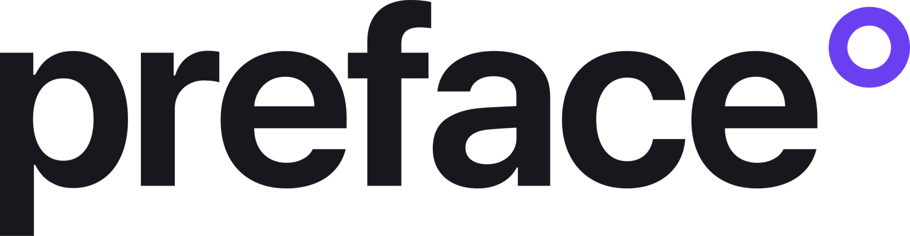
</picture>

**상상 말고, 내 3D 얼굴을 원하는 대로.**

휴대폰으로 얼굴을 한 바퀴 찍으면 내 3D 얼굴이 만들어지고,<br>
부위를 골라 원하는 만큼 바꿔 보며 전후를 비교하는 웹 서비스다.

**박민규 · AI 상담·3D 편집 연동**<br>
<sub>SSAFY 15기 2학기 프로젝트 · 7인 팀 · 대전 캠퍼스 발표회 진출</sub>

[개인 기여](#개인-기여) · [설계 결정](#핵심-설계-결정) · [서비스 소개](#주요-기능) · [팀 성과](#팀-성과) · [로컬 실행](#로컬-실행)

</div>

## 개인 기여

**Spring 상담 API와 React 상담 화면**을 구현했다. 자연어 요청을 편집 후보로 해석하고, 서버가 검증·저장한 결과를 **3D 화면·대화 기록과 연동했다.**

| 담당 영역 | 직접 구현·개선한 내용 |
| --- | --- |
| 상담·편집 적용 | 자연어를 지원 효과의 후보로 해석하고, 추가 질문·서버 검증·저장 결과를 대화와 변경 카드에 연결했다 |
| 근거 기반 추천 | 현재 시안의 측정·조절 전후 시험값과 연결된 후보를 검증하고, 슬라이더·3D 비교로 이어 줬다 |
| 상태·실패 복구 | 중복 LLM 호출과 오래된 제안의 적용을 차단하고, 화면 복귀 시 저장된 추천·적용 결과를 복원했다 |

**담당 기술:** Java·Spring Boot, React·TypeScript, Redis, LLM API(SSAFY GMS)

공통 3D 편집 엔진·모델 검증 계약은 관련 팀원과 연동했다. 복원 속도·생성 실패율·유저 테스트 결과는 아래에서 **팀 성과**로 구분했다.

### AI 상담 시연

<table>
<tr>
<td width="48%" align="center">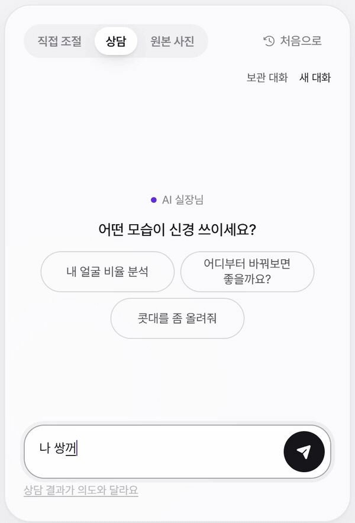</td>
<td valign="middle">

**이미 바꾼 부위는 유지하고, 다음 조절을 제안한다.**

쌍꺼풀을 바꾼 뒤 다음 조절을 묻는 상황이다. 현재 시안과 유지할 부위를 반영해 사각턱·턱끝 길이 카드를 제시한다.

**자연어 질문 → 유지 조건 해석 → 현재 시안에 근거한 추천**을 확인할 수 있다. 추천 카드는 해당 조절과 3D 비교로 이어진다.

<sub>2026-11-17 발표자료에 수록된 실제 상담 UI다. 얼굴·계정 정보가 없는 카드 영역만 사용했다.</sub>

</td>
</tr>
</table>

## 핵심 설계 결정

### 1. AI의 해석과 얼굴의 변경을 별도 단계로 처리했다

AI가 요청을 이해해도 모델에서 지원하지 않거나 저장에 실패하면 얼굴은 바뀌지 않는다. 상담 API는 **편집 후보**를 만들고, 적용 API가 소유권·`stateVersion`·모델별 허용 범위와 형상 검증 결과를 확인한 뒤 저장하도록 연결했다. 화면의 성공 안내·변경 카드는 저장된 `applyResult`를 기준으로 만든다. 실패한 후보가 대화 기록에서 적용된 것처럼 보이지 않게 처리했다.

외부 LLM 호출은 DB 트랜잭션 밖에서 수행하고, 저장 시점에 상태를 다시 확인한다. 같은 요청 ID는 Redis에서 7일간 선점해 재전송 시 LLM을 다시 호출하지 않는다.

[상담·저장 구현](services/backend/api/src/main/java/com/preface/api/consult/service/ConsultService.java) · [호출 중복 차단](services/backend/api/src/main/java/com/preface/api/consult/service/SpringConsultClient.java#L2069) · [클라이언트의 적용 결과 처리](apps/web/src/features/edit/lab/useConsult.ts#L80)

### 2. 추천의 근거를 현재 3D 시안과 연결했다

일반적인 미용 조언은 사용자가 이미 바꾼 얼굴이나 유지하려는 부위를 반영하지 못한다. 현재 시안에서 조절 전후를 시험한 측정값과 참고 자료를 후보에 연결하고, LLM에는 그 후보 안에서 선택·설명하도록 요청했다. 반환된 후보·측정·근거 ID와 방향을 다시 대조해, 준비한 근거와 맞지 않는 결과는 채택하지 않는다.

추천 카드는 이유를 읽는 데서 끝나지 않고 해당 슬라이더와 3D 비교를 열 수 있게 했다. 새 시안에 예전 측정값을 표시하거나, 반영되지 않은 변경을 이미 적용했다고 설명하지 않게 했다.

[추천 근거·응답 검증](services/backend/api/src/main/java/com/preface/api/consult/service/NextAdjustmentEvidence.java) · [현재 시안·비교 UI](apps/web/src/features/edit/lab/ConsultPanel.tsx) · [전후 측정 기반 추천 테스트](services/backend/api/src/test/java/com/preface/api/consult/service/SpringConsultClientTest.java#L3079)

### 3. 대화와 편집 상태가 어긋나는 경우를 검증했다

상담 도중 슬라이더를 움직이거나 새 대화를 시작하면 이전 제안이 현재 얼굴과 맞지 않을 수 있다. 후보를 시안의 편집 버전·대화 경계와 연결하고, 오래된 제안의 적용은 차단했다. 상담 화면으로 복귀할 때는 서버에 저장된 추천·적용 결과를 복원한다.

정상 응답과 **중복 요청·LLM 실패·버전 충돌·대화 전환·화면 복귀** 동작을 회귀 테스트로 확인했다.

| 확인할 상황 | 기대 동작 | 검증 코드 |
| --- | --- | --- |
| 같은 상담 요청을 재전송 | LLM 호출과 대화를 중복 생성하지 않는다 | [통합 테스트](services/backend/api/src/test/java/com/preface/api/consult/ConsultFlowIT.java#L1218) |
| LLM 응답이 지연되거나 실패 | 사용자 메시지·편집 후보를 저장하지 않는다 | [실패 경로 테스트](services/backend/api/src/test/java/com/preface/api/consult/ConsultFlowIT.java#L1118) |
| 상담 후 편집 버전이 달라짐 | 변경을 거절하고 얼굴과 이력을 유지한다 | [버전 충돌 테스트](services/backend/api/src/test/java/com/preface/api/consult/ConsultFlowIT.java#L1027) |
| 새 대화에서 이전 후보를 적용 | 기존 편집은 보존하고 이전 후보 적용은 차단한다 | [대화 경계 테스트](services/backend/api/src/test/java/com/preface/api/consult/ConsultFlowIT.java#L87) |
| 슬라이더에서 상담으로 복귀 | 기존 추천과 비교 동작을 유지한다 | [화면 복귀 테스트](apps/web/src/features/edit/lab/ConsultPanel.test.tsx#L200) |

각 테스트에서 해당 상황의 입력과 기대 결과를 확인할 수 있다. 서비스 간 책임은 [상담·편집 적용 계약](contracts/edit/consult-apply-v1.md)에 정리했다.

## 왜 만들었나

원하는 얼굴의 변화를 말이나 다른 사람의 사진만으로 설명하기는 어렵다. Preface는 자기 얼굴을 입체로 보고 직접 바꾸면서, 원하는 모습을 구체화할 수 있도록 만든 서비스다. 사전 사용자 조사에서도 기존 시뮬레이션과 상담의 어려움을 확인했다.

<details>
<summary>발표자료의 상황 예시 3종 보기</summary>

<table>
<tr>
<td width="33%" align="center">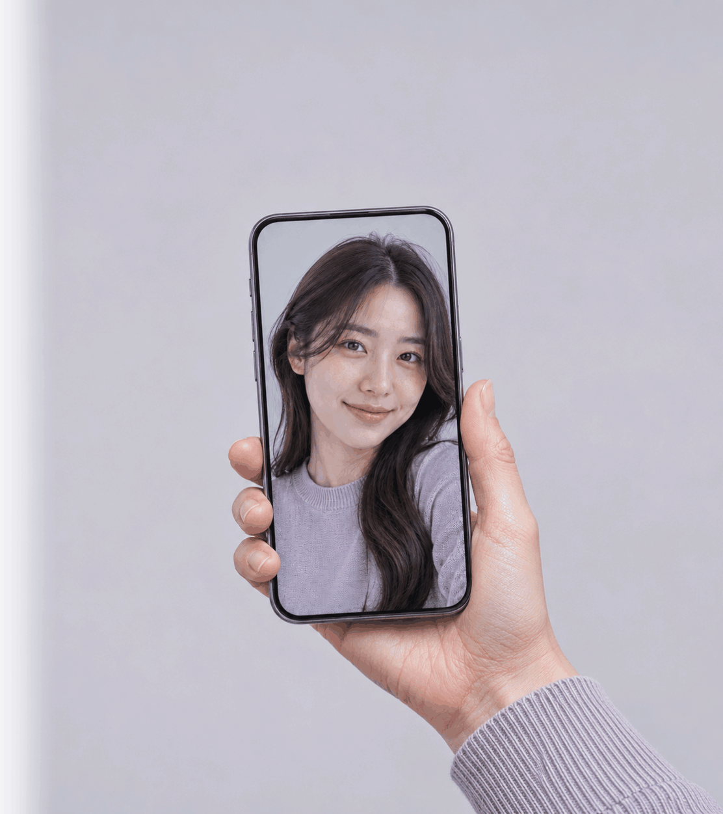<br><b>2D 시뮬레이션의 한계</b></td>
<td width="33%" align="center">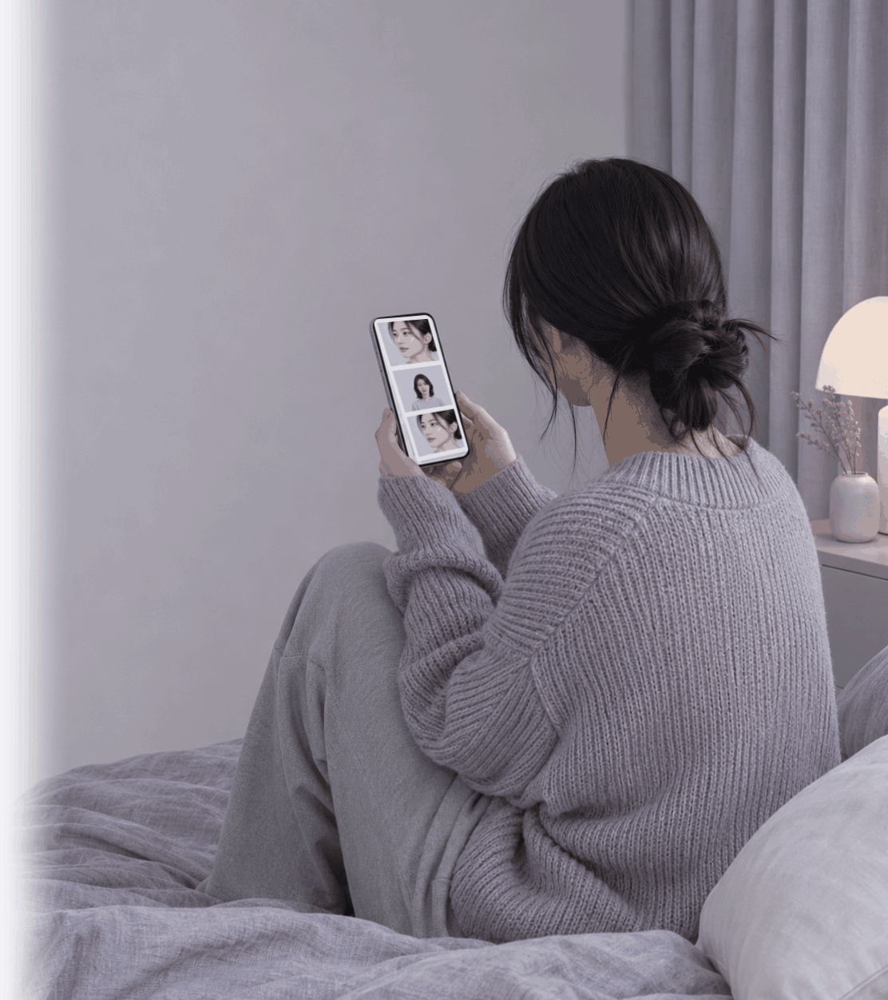<br><b>병원 방문의 부담</b></td>
<td width="33%" align="center">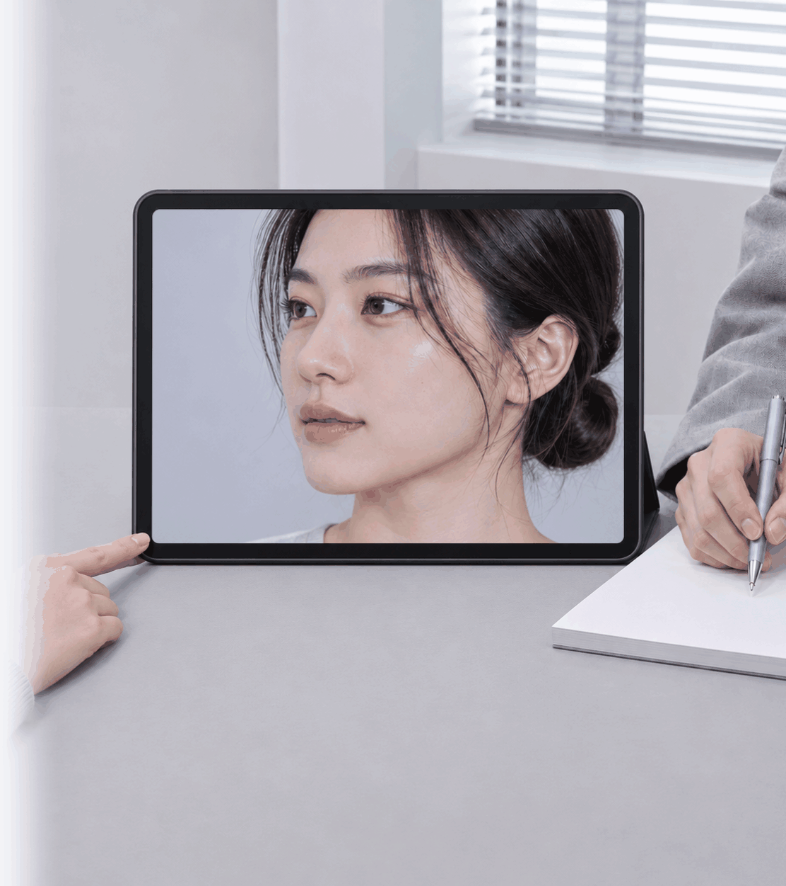<br><b>말과 참고 사진으로 하는 상담</b></td>
</tr>
</table>

<sub>발표자료의 가상 인물 상황 예시다. 실제 사용자·환자의 사진이나 조사 장면이 아니다.</sub>

</details>

| 문제 | 조사 결과[^survey] |
| --- | --- |
| **2D 시뮬레이션의 한계** | 써 본 사람 중 실제 결정·상담에 참고한 사람은 **7.3%** |
| **병원 방문의 부담** | 1차 유저 테스트에서 성형외과에 직접 가서 상담받는 것이 부담스럽다는 의견이 나왔다 |
| **상담은 말과 남의 얼굴로 한다** | 71.4%가 원하는 모양을 말로 설명했고, 의사와 "같은 그림"을 그린다고 느낀 사람은 **42.9%** |

## 주요 기능

<table>
<tr>
<td width="50%" valign="top">

**📱 3D 얼굴 만들기**<br>
앱 설치 없이 휴대폰 브라우저로 녹화한다. 음성 안내를 따라 얼굴의 좌우·위아래를 천천히 담으면 된다.

</td>
<td width="50%" valign="top">

**🎚️ 성형 시뮬레이션**<br>
부위를 고르고 슬라이더를 움직이면 3D가 바로 바뀐다. 돌려 보며 옆모습까지 확인하고 전후를 비교한다.

</td>
</tr>
<tr>
<td valign="top">

**💬 AI 상담실장**<br>
고민을 말하면 AI가 어느 부위를 얼마나 바꾸면 좋을지 제안하고, 그 제안을 바로 편집에 반영한다.

</td>
<td valign="top">

**🙂 표정 트래킹**<br>
카메라 앞 얼굴을 MediaPipe가 읽고, 내 3D 얼굴이 고개 방향과 표정(미소·놀람·찡그림·볼 부풀리기)을 따라 한다.

</td>
</tr>
</table>

> 시뮬레이션이며 수술 결과 예측이 아니다.

<p align="center">
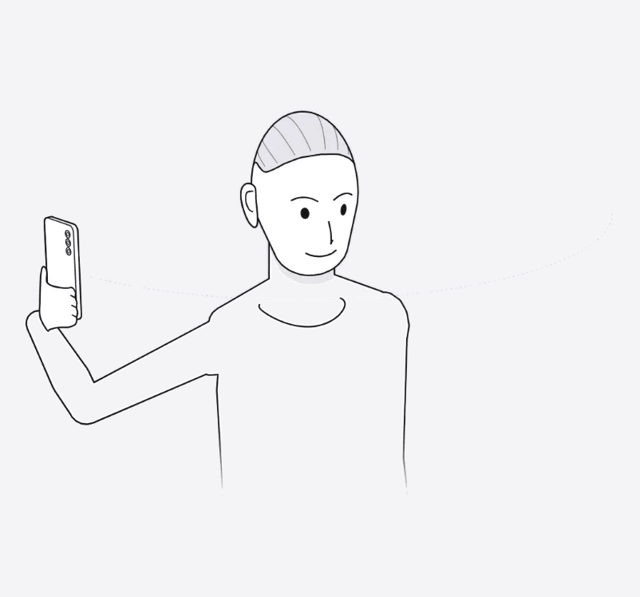<br>
<sub>촬영 안내: 앱 설치 없이 휴대폰 브라우저에서 얼굴의 여러 각도를 담는다.</sub>
</p>

## 휴대폰 영상 47초가 3D 얼굴이 되기까지

<details>
<summary>팀이 구현한 3D 생성 파이프라인과 시연 수치</summary>

<br>

<table>
<tr>
<td width="50%" align="center">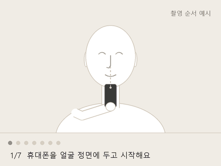<br><sub>① 녹화: 음성 안내를 따라 얼굴을 한 바퀴 담는다</sub></td>
<td width="50%" align="center">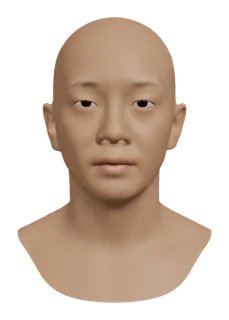<br><sub>④ 모든 결과는 같은 구조의 기본 머리에서 출발한다.<br>그래서 누구의 얼굴이든 같은 제어점으로 편집한다</sub></td>
</tr>
</table>

| 단계 | 하는 일 | 쓰는 기술 | 시연 녹화 1건의 수치 |
| --- | --- | --- | --- |
| ① 녹화 | 휴대폰으로 얼굴 한 바퀴 찍기 | 휴대폰 브라우저 · 음성 안내 · 자이로 | 46.9초, 1,406프레임 |
| ② 사진 고르기 | 각도마다 가장 선명한 사진 | 자이로·얼굴 각도 2.5° 칸 · 선명도 점수 | 91장 (흐림·눈 감음 제외) |
| ③ 카메라·깊이 | 카메라 위치와 얼굴 깊이 계산 | COLMAP SfM · SIFT 특징점 · 사람 분할 마스크 | 사진 87장이 함께 찾은 얼굴 점 3,962개 |
| ④ 머리 맞추기 | 기본 머리를 내 얼굴 모양으로 | Google GNM 통계 머리 · SfM 점 · 얼굴 윤곽 맞춤 | 정점 17,821개, 모두 같은 구조 |
| ⑤ 부위 맞추기 | 기본 머리가 못 만드는 부위를 사진으로 | 눈꺼풀 접힘선 · 코 옆선·콧구멍 · 얼굴·목 경계 | 3부위 |
| ⑥ 색 입히기 | 사진 색을 3D 피부에 입히기 | GPU 텍스처 굽기 · 사람별 헤어라인 · 민머리 피부 | 2048×2048 피부 지도 |
| ⑦ 결과 확인 | 실제 사진과 겹쳐 닮았는지 확인 | 찍은 카메라 그대로 3D를 그려 비교 | 만들 때 안 쓴 사진 18장으로 채점 |

</details>

## 팀 성과

3D 복원·촬영·인프라·화면 개선을 합친 팀의 결과다. 개인 담당 기능의 성능 수치로 해석하지 않는다.

<table>
<tr>
<td width="50%" align="center">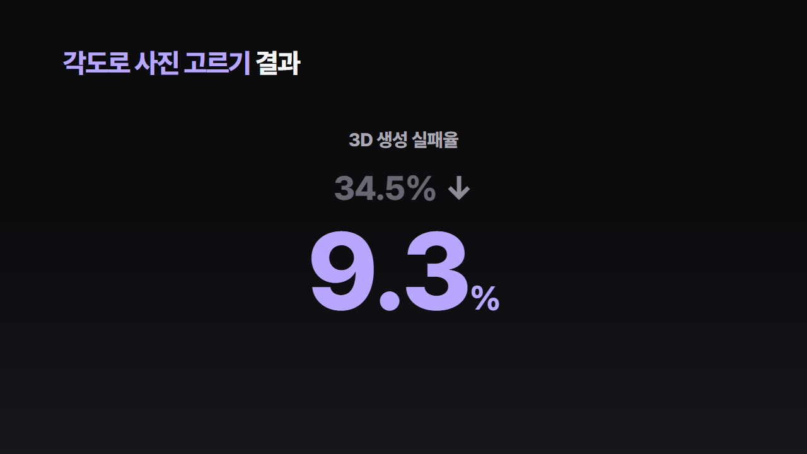<br><sub><b>3D 생성 실패율</b></sub></td>
<td width="50%" align="center">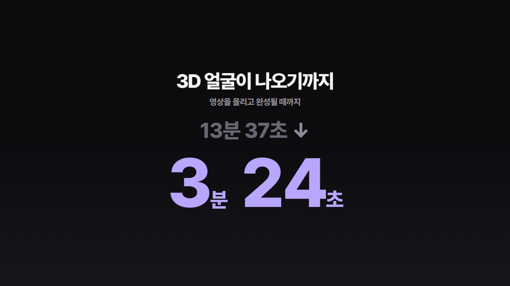<br><sub><b>3D 생성 시간</b></sub></td>
</tr>
<tr>
<td align="center">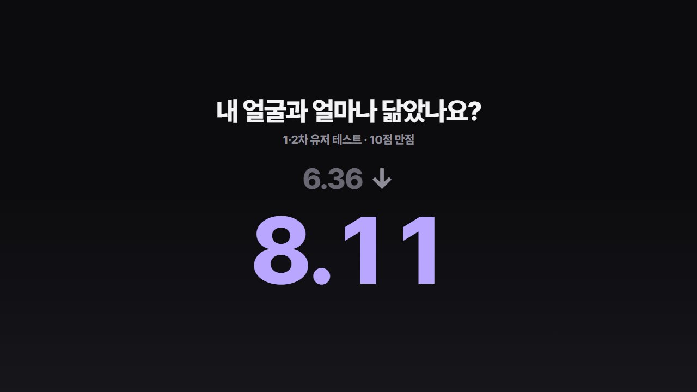<br><sub><b>얼굴 유사도 · 10점 만점</b></sub></td>
<td align="center">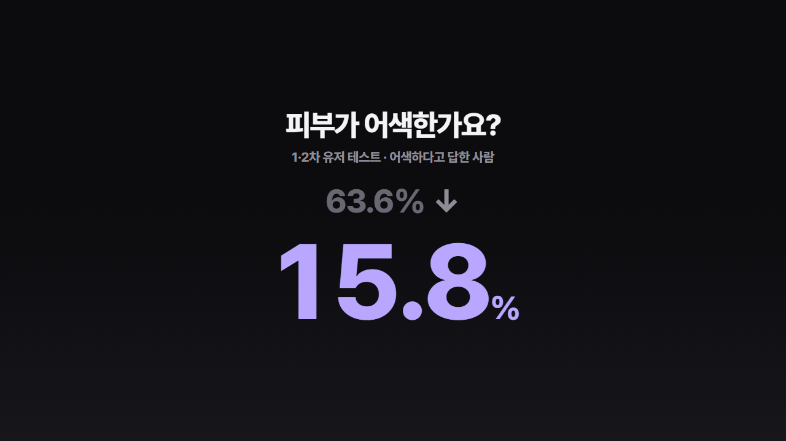<br><sub><b>피부가 어색하다는 응답</b></sub></td>
</tr>
</table>

발표자료의 생성 실패율[^ops]·생성 시간[^time]·1·2차 유저 테스트[^ut] 결과다. 이미지를 누르면 원본 크기로 볼 수 있다.

## 팀의 3D 복원 개선

결과에 가장 크게 영향을 준 세 가지다. 그 밖에 부딪힌 문제(평균 얼굴로 채워진 부위, 쌍꺼풀이 사라짐, 기종마다 다른 카메라·자이로 축, 텍스처 이음매, 카톡 압축 화질 등)는 [발표 자료](https://preface-presentation.vercel.app)에 있다.

<details>
<summary><b>1. 옆에서 보면 코가 튀어나왔다 — 측면 깊이 부정확</b></summary>
<br>

- **문제**: MediaPipe 얼굴 점을 깊이 기준으로 삼으면 정면은 그럴듯해도 옆에서 코와 얼굴 윤곽이 어긋났다.
- **원인**: MediaPipe는 사진마다 468개 기준점을 새로 짐작해 찍는다. 고개를 돌릴수록 같은 번호의 점이 실제 피부 자리에서 미끄러져, 사진마다 다른 자리를 가리킨다.
- **해결**: SIFT로 눈꼬리·점·주름처럼 모양이 또렷한 곳을 사진끼리 짝짓고, COLMAP SfM으로 카메라 위치와 3D 점을 계산해 깊이와 머리 자세를 정했다. MediaPipe 점은 부위 이름표로만 쓴다.
- **결과**: 깊이는 SfM 점에서 얻고, MediaPipe는 얼굴 부위를 식별하는 단서로 사용하도록 역할을 나눴다. 사진의 측면 윤곽에 맞추는 방향으로 복원을 개선했다.

</details>

<details>
<summary><b>2. 세 번에 한 번 3D 생성이 실패했다 — 사진 고르기</b></summary>
<br>

- **문제**: 1차 배포 뒤 운영에서 55건 중 19건(34.5%)이 실패했다.
- **원인**: 영상을 같은 시간 간격으로 나눠 사진을 골랐다. 사람마다 찍는 방식이 달라, 오래 멈춘 정면에는 같은 각도 사진이 쌓이고 빠르게 지나간 옆에는 빈틈이 생겼다. 이 빈틈 때문에 카메라 위치를 맞추지 못했다.
- **해결**: 녹화하는 동안 각도를 함께 기록하고, 시간 대신 **2.5° 각도 칸**으로 사진을 고른다. 얼굴 추적은 옆으로 약 60°를 넘으면 얼굴을 놓쳐서 좌우는 휴대폰 **자이로**로 잰다. 자이로 값은 같은 녹화의 얼굴 각도와 맞을 때만 쓴다.
- **결과**: 발표자료에서 생성 실패율이 **34.5% → 9.3%**로 낮아졌다.

</details>

<details>
<summary><b>3. 한 명에 13분이 걸렸다 — 모델링 시간</b></summary>
<br>

| 원인 | 해결 | 효과 |
| --- | --- | --- |
| 피부 지도 약 400만 칸마다 사진 수십 장의 색을 섞는 계산을 CPU에서 반복 | PyTorch로 GPU에서 반복 계산을 병렬 처리 | 텍스처 베이킹 시간 단축 |
| 사진별 독립 계산을 한 장씩 순서대로 수행 | 여러 CPU 코어에서 병렬로 처리 | CPU 자원 활용 개선 |
| PoC 확인용 계산까지 서비스 실행 경로에서 수행 | 결과에 쓰이지 않는 계산 제거 | 불필요한 실행 시간 절감 |

모두 합쳐 **817초(13분 37초) → 204초(3분 24초)**, 4분의 1이 됐다.

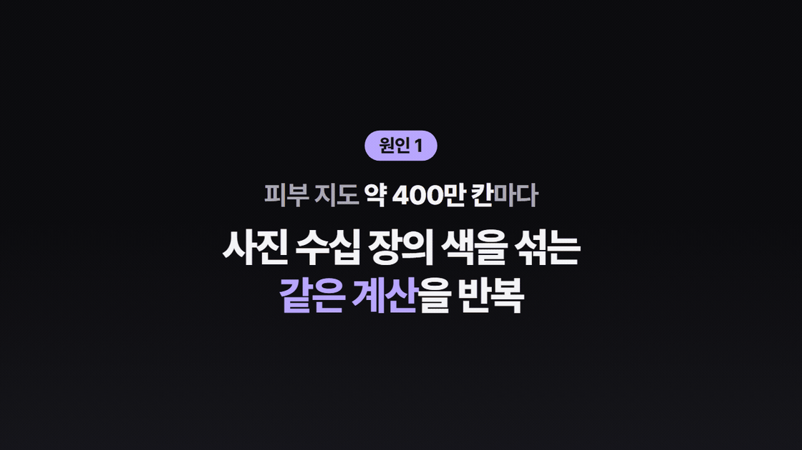

<sub>텍스처 베이킹의 CPU·GPU 처리 개념을 비교한 발표 애니메이션이다.</sub>

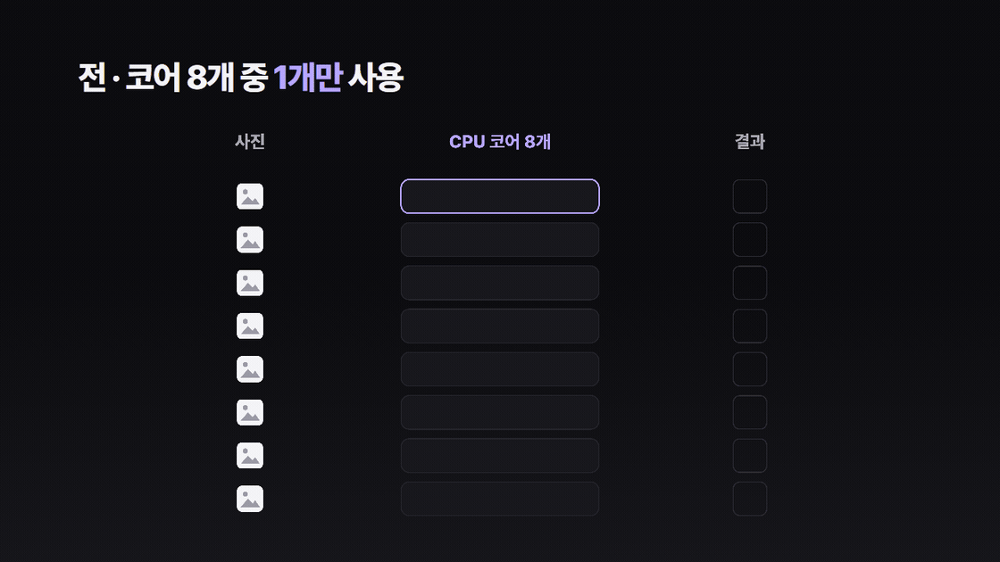

<sub>사진별 독립 계산의 순차·병렬 처리 개념이다. 코어 8개로 단순화한 설명이며 실시간 자원 사용량 화면이 아니다.</sub>

</details>

### 여러 명이 한꺼번에 요청하면

한 건을 빠르게 만드는 것과 대기열을 줄이는 것은 별개의 문제였다. 1차 배포에서는 워커 하나가 한 명씩 처리했다. 2차 배포에서는 **Redis 리스트에 작업을 대기시키고 GPU 워커 4개가 나눠 처리**하도록 운영했다.

캠퍼스 부스에서 **23명의 요청이 집중된 운영 사례의 평균 완료 시간은 5분 53초**였다. 이는 해당 운영 사례의 결과이며, 지속적인 동시접속 23명이나 최대 처리량을 보장하는 부하 테스트 수치는 아니다.

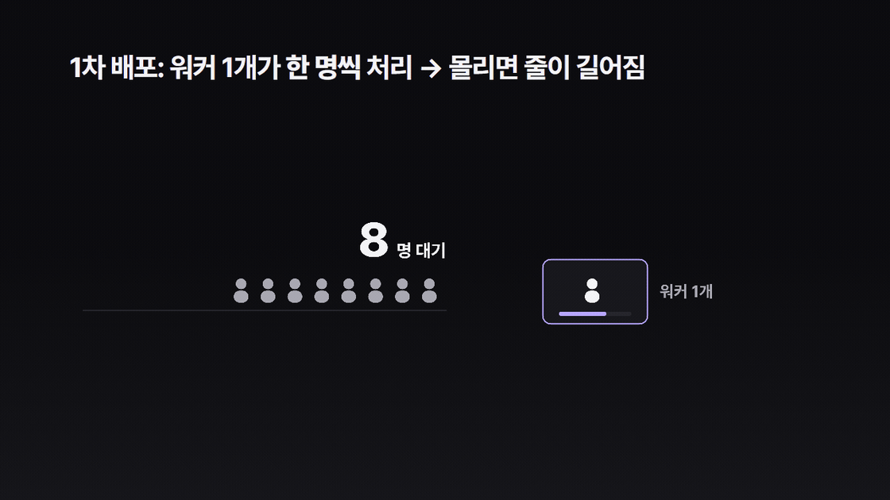

<sub>워커 1개와 4개의 처리 구조를 설명한 개념 애니메이션이다. 화면의 대기 인원·시간은 운영 로그나 부하 테스트 계측값이 아니다.</sub>

## 시스템 아키텍처

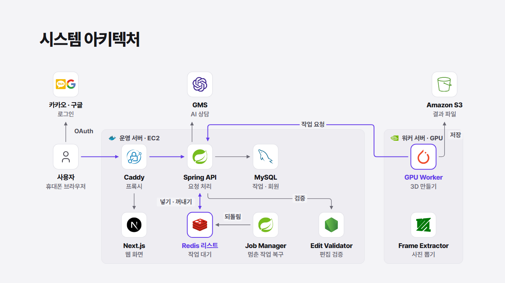

<details>
<summary>구성 요소와 연결을 텍스트 다이어그램으로 보기</summary>

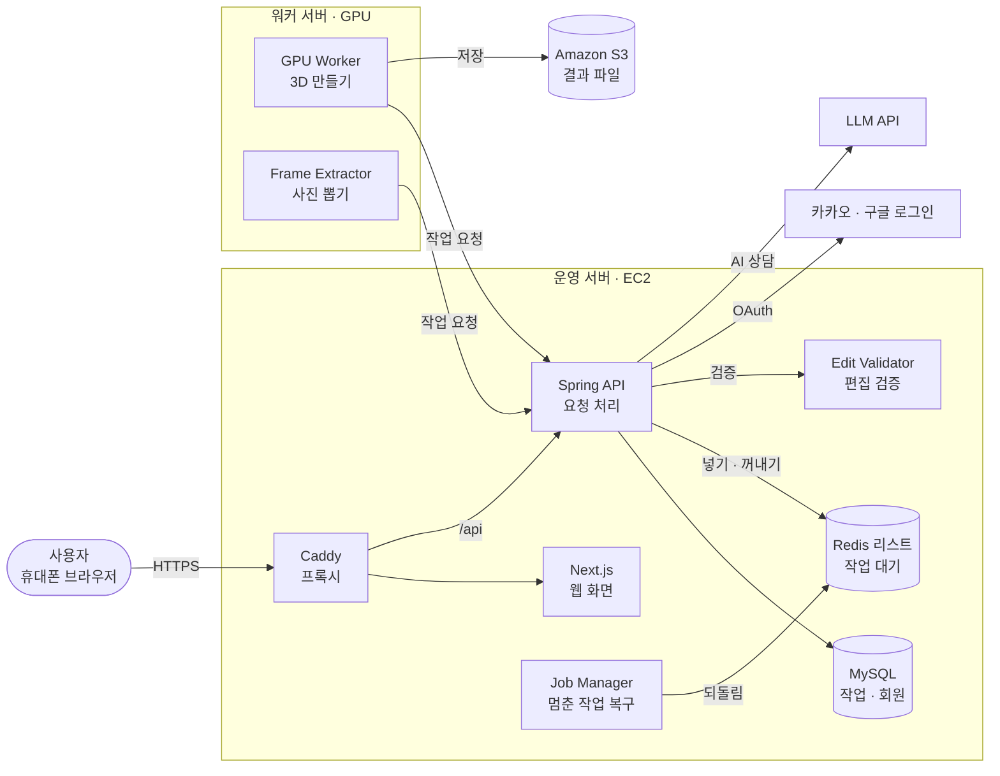

</details>

GPU 워커는 Redis에 직접 붙지 않고 API에 작업을 요청해 받아 간다. API와 Job Manager는 진행 보고와 lease를 통해 중단 작업을 관리한다.

## 기술 스택

| 영역 | 기술 |
| --- | --- |
| Frontend | Next.js 16 · React 19 · TypeScript · Tailwind CSS 4 · Zustand 5 · three.js · React Three Fiber · MediaPipe |
| Backend | Java 25 · Spring Boot 4.1 · Spring Security · Spring Data JPA · Flyway · MySQL 8 · Redis 7 |
| AI · 3D | Python 3.12 · PyTorch 2.14 (CUDA 12.6) · FastAPI · COLMAP(pycolmap) · OpenCV · MediaPipe · SciPy · Google GNM |
| Infra | AWS EC2 · Amazon S3 · Caddy · Docker · GitLab CI · RunPod · Prometheus · Grafana |

의존성 버전은 각 영역의 manifest와 lock 파일을 기준으로 한다.

## 로컬 실행

Node.js 24와 pnpm 11을 준비한 뒤 웹을 실행한다.

```sh
git clone https://github.com/scnelMG/preface.git
cd preface/apps/web
corepack enable pnpm
pnpm install --frozen-lockfile
cp .env.example .env.local
pnpm dev
```

`http://localhost:3000/lab`에서 합성 기본 모델을 사용하는 화면을 확인한다. 로그인·상담·개인 모델 생성은 백엔드, 스토리지, OAuth·LLM API(GMS) 설정과 GPU 환경이 추가로 필요하다. [개발·검증 명령](docs/development.md)

공개본은 운영 접속 정보와 재배포 범위를 확인하지 못한 홍보용 자산을 제외했다. 랜딩의 일부 영상·3D 연출은 포함되지 않으며, 원본 운영 서비스를 명령 한 번으로 재현하는 배포 패키지는 아니다. [공개 범위와 제외 항목](docs/public-scope.md)

## 저장소 구조

| 경로 | 내용 |
| --- | --- |
| [`apps/web`](apps/web) | 프론트엔드 (Next.js) |
| [`services/backend`](services/backend) | API·작업 관리자 (Spring Boot) |
| [`services/gpu-worker`](services/gpu-worker) | 3D 얼굴 생성 (FastAPI·PyTorch) |
| [`contracts`](contracts) | 서비스 간 API·메시지 계약 |
| [`infra/local`](infra/local) | 로컬 MySQL·Redis·S3 호환 스토리지 |
| [`scripts`](scripts) | 평가·검사 도구 |
| [`docs`](docs) | 공개용 설명·합성 검증 자료 ([문서 지도](docs/README.md)) |

전체 운영 배포 설정과 팀 내부 작업 절차는 이 공개 사본에 포함하지 않는다.

## 팀

<div align="center">

| 양은하 | 나주원 | 오민근 | 고우정 | 김채원 | 김민서 | **박민규** |
| :---: | :---: | :---: | :---: | :---: | :---: | :---: |
| 팀장 · FE · QA | INFRA · QA | BE · 발표 | AI · 3D | AI · 3D | AI · 3D | **AI · 챗봇** |

</div>

## 외부 자산

- 기본 머리 모델: Google GNM Head ([Apache License 2.0](apps/web/public/models/GNM-LICENSE.txt))
- 공개 샘플은 실제 사용자 얼굴이 아닌 합성 모델이다. [출처·변경 내역](apps/web/public/models/manifest.json)
- 프로젝트 전체에 새로운 오픈소스 라이선스를 임의로 부여하지 않았다.
- README의 이미지·애니메이션은 제공된 발표자료에서 가져왔다. [파일별 출처·변환 내역](docs/assets/readme/README.md)

## 공개 사본 안내

SSAFY 15기 7인 팀이 개발한 preface를 개인 포트폴리오로 소개하는 저장소다. 팀원과 담당 영역을 보존하고, 개인 기여와 팀 성과를 구분했다. 원본 GitLab의 최종 코드에서 공개용 사본을 만들었으며 과거 Git 이력·Jira·MR·운영 자료는 옮기지 않았다.

실제 얼굴 사진·촬영 영상·개인화 모델, 토큰·비밀번호·개인 환경 파일은 공개 대상에서 제외한다. [공개본의 기준과 검증 범위](docs/public-scope.md)

---

[^survey]: 사전 사용자 조사. 7.3%는 시뮬레이션을 써 본 사람 기준, 71.4%·42.9%는 상담을 받아 본 사람 기준이며 복수 응답이다.
[^ops]: 2026-11-17 발표자료의 각도 기반 프레임 선택 전후 결과. 이전 값은 55건 중 19건 실패다. 개선 후 분모는 제공된 발표자료에 명시되어 있지 않다.
[^time]: 발표자료의 영상 업로드부터 3D 완성까지 비교. 전 817초, 후 204초다. 같은 하드웨어·표본으로 반복한 통제 벤치마크로 해석하지 않는다.
[^ut]: 1·2차 유저 테스트의 발표 결과다. 유사도는 10점 척도이며 피부 응답은 복수 응답이다. 제공된 발표자료만으로 동일 참여자의 전후 평가나 문항 조건의 동일성을 확인하지 못했다.
